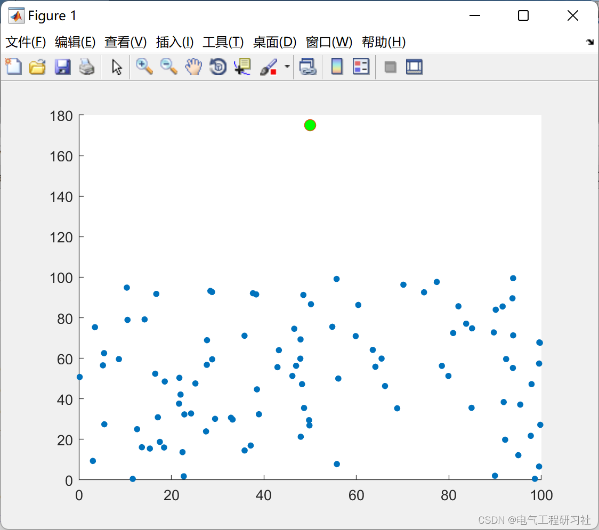
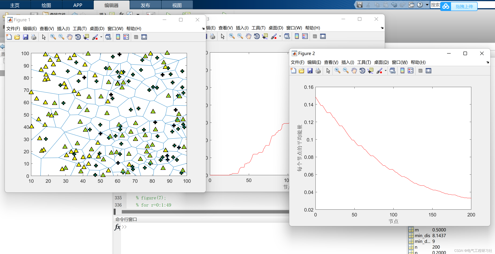
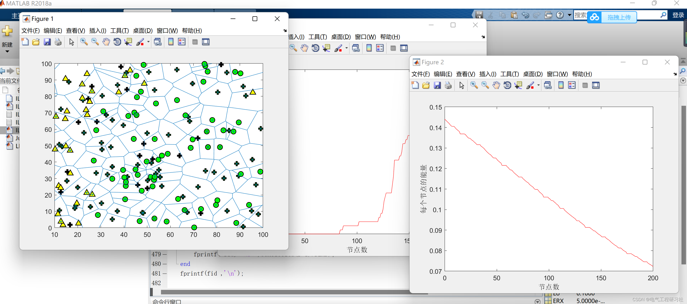
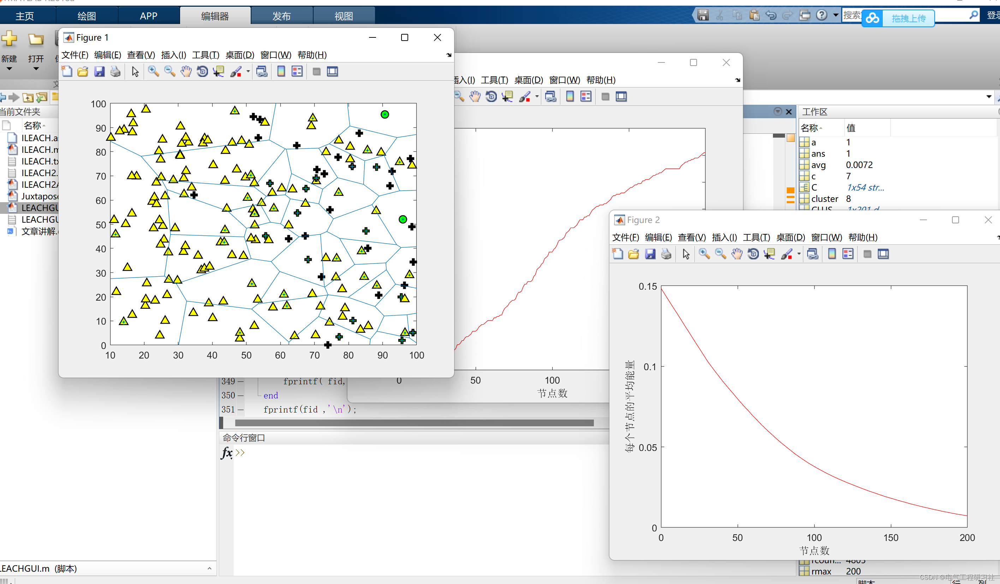
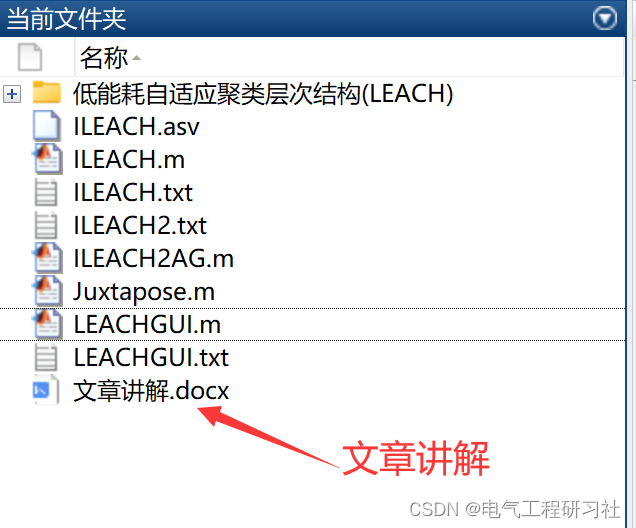
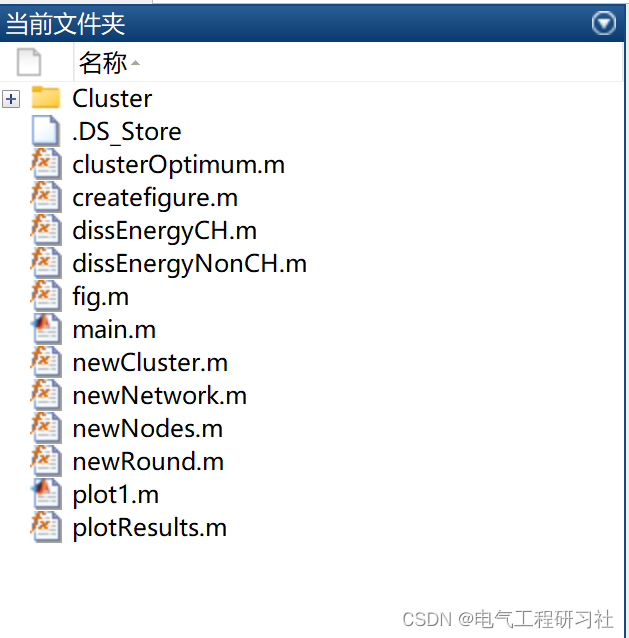

# Low-energy Adaptive Clustering Hierarchy (LEACH) based on Matlab code implementation

​  
📋📋📋This article is organized as follows: ⛳️⛳️⛳️​Table of Contents: 1. Overview 2. Running Results 2.1 Low-Energy Adaptive Hierarchical Clustering (LEACH) 2.2 Improved Low-Energy Adaptive Hierarchical Clustering (OHILEACH) 3. Explanation of the Article's Details 4. MATLAB Code Implementation 5. Final Thoughts This paper considers the general framework of multi-hop WN (wireless network) distributed mechanism. Cluster-based routing protocols, such as Low Energy Adaptive Clustering Hierarchy (LEACH), Mixed Efficiency Protocol (HEEP), Threshold-Sensitive Energetic Network Protocol (TEEN), and PegGAS, can effectively manage energy usage. However, these agreements should still be thoroughly studied and revised to achieve higher energy efficiency. This paper focuses on introducing the LEACH protocol, where the process of cluster head (CH) selection is referred to as "round" (r). Every round takes up the setting and steady-state phase of the network. Based on the study of LEACH and its variants, researchers proposed a beneficial positioning based on energy model (EM). EM is applied to CH and non-CH nodes, used for balancing energy in the network.
2. Running Results 2.1 Low-Energy Adaptive Hierarchical Clustering (LEACH) Edit
2.2 Improved Low-Energy Adaptive Hierarchical Clustering (OHILEACH)
New emerging WSN (Wireless Sensor Network) fields combine sensing, computing, and communication in a tiny embedded device. Each node, as an individual device, may have limitations, but when it collects "N" battery-powered SNs based applications are determined or randomly distributed across a region, they form a connected ocean extending into the physical world, providing real-time data for analysis [20]. These miniature devices combined together provide massive data for base stations (BS). Examples include wildlife monitoring systems, weather monitoring systems, WSBN - electronic health solutions for remote patient monitoring. SNs should collect information related to sensors and utilize communication paths by searching destinations from one node to another. Typically, the target node can be referred to as a base station. Smart grids, smart homes, smart water networks, and smart transportation all connect to the physical world, also known as the Internet of Things (IoT). WSN is considered a revolutionary method for collecting information in the construction of information communication systems, significantly enhancing the reliability and efficiency of infrastructure systems. These nodes are deployed in dangerous and remote areas, making it impossible or impractical to replace batteries. Battery life is crucial for maintaining node activity because large capacity batteries cannot be deployed. The primary energy utilization is due to the computation operations performed and data transmission/reception.
Edited by:
Edited by:
Edited by:
3 Article detailed content explanation see section four.
4 Matlab code implementation only showcases part of the code, all codes available here:
Edited by:
Edited by:
5 End notes theoretical references to network literature, if any infringement please contact blogger to delete.

## Images

<!-- PAYMENT_BLOCK -->

## Get this dataset

- Payment link (Stripe): [Buy now](https://buy.stripe.com/3cs8yP7sY87d0vu9AB)
- Payment QR code: 

<!-- /PAYMENT_BLOCK -->
